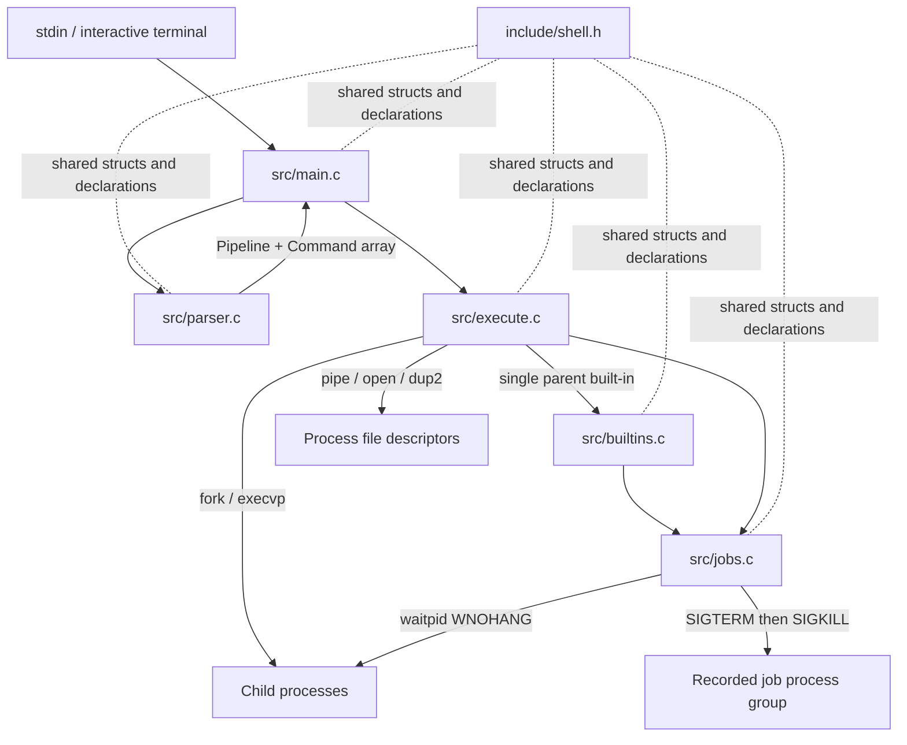

# Architecture and Process Diagrams

## Module Boundaries



## Command Lifecycle

```mermaid
sequenceDiagram
    participant U as User/stdin
    participant M as main loop
    participant P as parser
    participant E as executor
    participant C as child process(es)
    participant J as job manager
    U->>M: command line
    M->>J: reap completed children
    M->>P: parse_line(line)
    P-->>M: Pipeline or syntax error
    alt standalone parent built-in
        M->>E: execute_pipeline
        E-->>M: built-in status
    else external command or pipeline
        M->>E: execute_pipeline
        E->>C: fork, process group, descriptors, execvp
        alt foreground
            E->>C: waitpid each stage
            E-->>M: final-stage status; restore terminal
        else trailing &
            E->>J: register PGID and PIDs
            E-->>M: return prompt
        end
    end
    J-->>M: Running/Done records for jobs
    M->>J: cleanup on exit or EOF
    J->>C: TERM, bounded wait, KILL if needed, reap
```

## Descriptor Wiring

For a pipeline `A | B | C`, the parent creates two pipes before forking. Child A connects stdout to pipe 1's write end; child B connects stdin to pipe 1's read end and stdout to pipe 2's write end; child C connects stdin to pipe 2's read end. Every child closes all original pipe endpoints after `dup2()`. Redirections are applied after this wiring, so a stage's explicit `<` or output redirection takes precedence over its pipeline connection on that stream.

## Ownership and Safety Invariants

- The shell sends job signals only to a positive process group recorded in its own job table and never to its own process group.
- The signal handler performs no allocation, printing, or waiting; child status collection happens in ordinary code.
- Each forked foreground child is waited for by the foreground executor; background children are waited for by the job manager.
- Pipe cleanup checks each descriptor is nonnegative, including partial pipe-creation failure.
- `cd` and `exit` run in the parent only when they are standalone foreground commands.