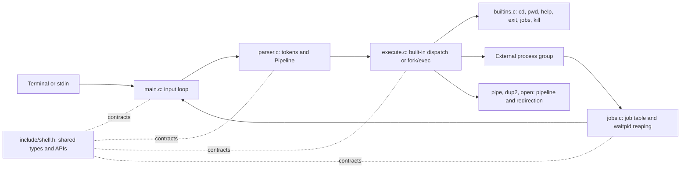

# Mini Linux Shell: Project Report

**OS Hackathon | Team G-3**
**Implementation language:** C11
**Platform:** Ubuntu/Linux with POSIX interfaces

## Abstract

`minish` is an educational command interpreter demonstrating how a Unix-like shell parses input, creates processes, connects their standard streams, and manages background work. Its implementation is split across five C translation units and a shared header. It supports parent-process built-ins, external commands, pipelines, file redirection, process-group-based background jobs, signal-aware child reaping, and bounded cleanup. The automated suite checks the externally visible behavior and difficult resource/lifecycle paths.

## Problem Statement and Objectives

An operating-systems shell assignment brings together several concepts that are easy to study separately but subtle when combined: parsing, `fork()`/`execvp()`, descriptor ownership, `waitpid()`, signals, and process groups. The objective is a practical, inspectable implementation that demonstrates these concepts without pretending to implement a complete production shell.

## Architecture

The shell owns a `Shell` state object containing job records, the next job ID, terminal/process-group information, and the final exit status. The parser returns a `Pipeline` containing ordered `Command` values. A command holds a NULL-terminated `argv`, optional input/output paths, and append mode. Each background `Job` stores its process group, member PIDs, per-process completion flags, and display text.

## Six Functional Modules

### 1. Command Parsing and Execution

`src/parser.c` tokenizes words, single/double quotes, backslash escapes, and the operators `|`, `<`, `>`, `>>`, and `&`. It rejects incomplete pipelines, missing redirection paths, duplicate redirections of the same direction, and a background marker that is not last. `src/execute.c` forks one child for each pipeline stage, creates a process group, wires standard input/output with `dup2()`, and calls `execvp()`. The parent waits for every foreground process and returns the final stage's status.

### 2. Built-in Commands

`src/builtins.c` implements `cd`, `pwd`, `help`, and `exit`, plus `jobs` and `kill %job-id` for the job-control workflow. A standalone built-in runs in the shell process so `cd` and `exit` affect the shell. Redirection on a parent built-in temporarily saves and restores standard descriptors. Built-ins used in a pipeline/background context run in a child, so their state changes do not affect the parent shell.

### 3. Background Job Management

Appending `&` to a pipeline starts it without a foreground wait. All stages share a process group, which is stored in a monotonically numbered job record. `jobs` reports each retained record as `Running` or `Done`; completed records remain visible for the session. `kill %N` resolves only a job ID from this table and signals that job's process group, never an arbitrary user-supplied PID.

### 4. Process and Signal Management

The shell installs a minimal `SIGCHLD` handler so terminal input can be interrupted when children change state. Reaping occurs in normal control flow using `waitpid(-1, ..., WNOHANG)`, not in the signal handler. Children restore default interactive signal dispositions. Foreground pipelines receive the controlling terminal while they run; the shell reclaims it after waiting. Job termination sends `SIGTERM`, polls for up to one second, escalates remaining members to `SIGKILL`, and reaps them. Shutdown applies the same bounded cleanup strategy to recorded background jobs.

### 5. I/O Redirection and Pipelines

Pipeline endpoints are created with `pipe()`. Each child connects the appropriate endpoint using `dup2()` and closes inherited pipe descriptors. Input redirection opens read-only; `>` creates/truncates; `>>` creates/appends. Redirections are applied after pipe wiring, so an explicit file redirection on a pipeline stage overrides that stage's corresponding pipe endpoint. If pipe creation fails, only successfully opened descriptors are closed; the failure path preserves descriptors 0, 1, and 2.

### 6. Error Handling, Validation, and Cleanup

The parser reports syntax errors without starting a process. Allocation, `open()`, `pipe()`, `fork()`, `dup2()`, `setpgid()`, and `waitpid()` failures are reported with context. Child-side failures use `_exit()` to avoid flushing inherited stdio buffers twice. The parent closes pipe descriptors on both success and failure paths. Background jobs are tracked and reaped; `exit` and EOF terminate only those recorded job process groups and wait for their children, with escalation for non-cooperative jobs.

## Build and Verification

Build with `make`; run the integration suite with `make test`. The test suite covers built-ins and parent `cd`, quoting and a pipeline, all three redirection forms, background completion/reaping, job-scoped termination, graceful cleanup, SIGTERM-resistant children, malformed syntax/missing commands, and pipe failure under descriptor exhaustion. Exact observed environment and results are in [TEST_RESULTS.md](TEST_RESULTS.md).

## Known Limitations

This is not a complete POSIX shell. It has no parameter/command expansion, globbing, command lists or control structures, heredocs, arbitrary file-descriptor redirection, stopped-job table, or `fg`/`bg`. Background `&` is accepted only at the end of the input pipeline. Pipeline status is taken from the final stage. The parser does not provide shell-safe execution for untrusted input; commands are executed with the user's normal privileges.

## Suggested Impact

The project provides a compact lab artifact for tracing how shell syntax becomes process topology and file-descriptor wiring. Instructors can extend it with stopped-job tracking, expansion, or a richer parser as separate exercises, using the included tests as a behavioral baseline.